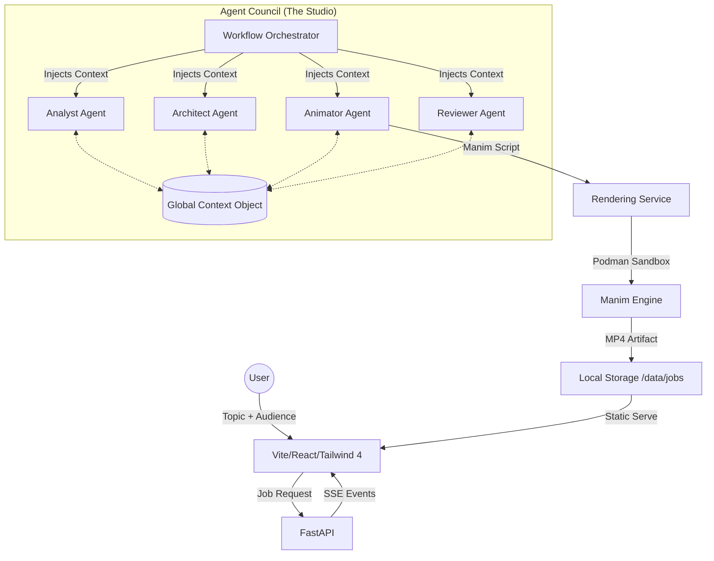

# Architecture

ConceptCast is a monorepo consisting of a FastAPI backend and a Vite/React frontend, driven by a sophisticated multi-agent orchestration layer.

## Data Flow & Orchestration

The system follows a **Layered Memory** architecture, where agents no longer act in isolation but interact with a centralized **Global Context Object (GCO)**.

## Core Methodologies

### 1. The Global Context Object (GCO)
Instead of a simple linear pipeline, all agents interact with a **GCO** that maintains:
- **Semantic Intent**: Core concepts and target audience goals.
- **Visual Lexicon**: Shared symbols and styles (ensuring Scene 1 colors match Scene 10).
- **Spatial Map**: Tracks screen real estate to prevent overlapping text and shapes.
- **Error Buffer**: Shared history of failures to guide retry and correction logic.

### 2. Layered Memory Architecture
- **Local Memory**: Pydantic AI's internal message history for agent-specific tool loops.
- **Shared Context**: Targeted "Injectors" that slice the GCO, providing only relevant information to an agent to prevent context bloat.
- **Global State**: The bird's-eye view maintained by the Orchestrator and persisted in the database.

### 3. Production Bible (Externalized Prompts)
System prompts are externalized in `src/prompts/`. This allows for rapid iteration of agent personas and strict enforcement of Manim-specific spatial reasoning and pedagogical rules without modifying application logic.

## Key Technologies
- **Backend**: FastAPI, Pydantic AI, SQLAlchemy (Async), Taskiq (Task Queue).
- **AI Docs**: Context7 (Real-time Manim & Library documentation).
- **Frontend**: React 19, Vite, Tailwind CSS 4, Framer Motion, TanStack Router/Query.
- **Infrastructure**: Podman for sandboxed rendering (with local execution fallback).
